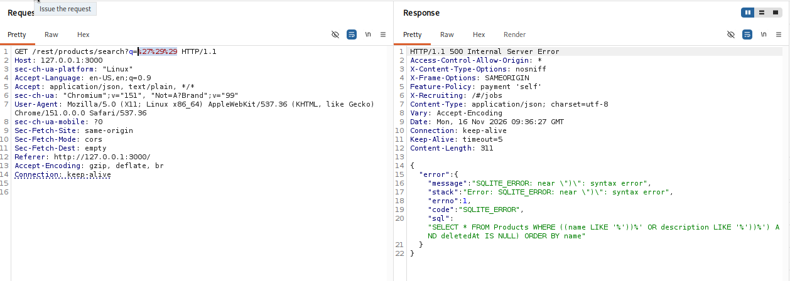
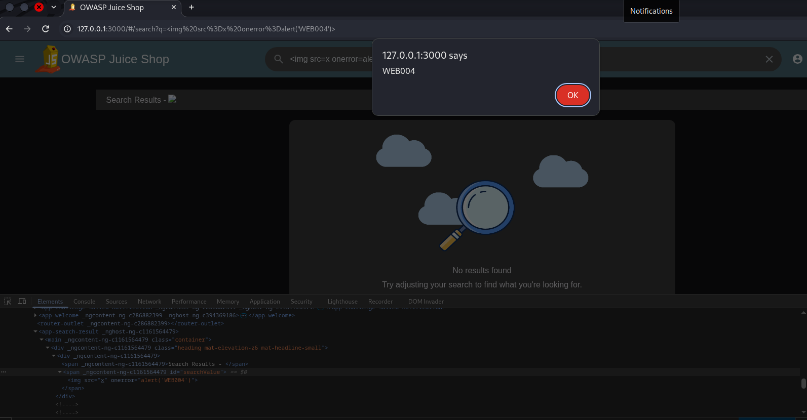
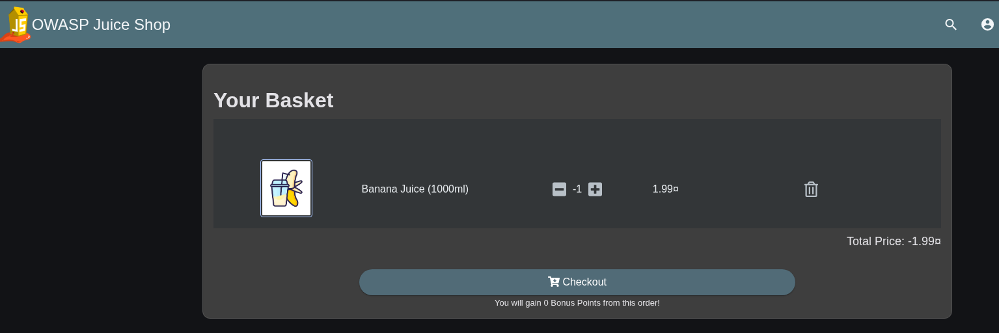

# Web Application Security Assessment — OWASP Juice Shop

**An evidence-driven web application security lab using Burp Suite Community Edition and a locally hosted OWASP Juice Shop instance.**

This project documents controlled manual testing of an intentionally vulnerable web application. The objectives are to analyze HTTP requests, validate security issues with repeatable tests, evaluate access controls, and produce technically accurate reports with remediation guidance.

> **Publication status:** Five investigations and **20 reviewed evidence screenshots** are documented. The repository remains **private** while final release checks are completed. All tests targeted a locally hosted intentionally vulnerable application; no production systems or third-party accounts were tested.

## At a glance

- **3 confirmed local findings:** SQL injection (WEB-001), DOM-based XSS (WEB-004), and negative basket quantity / incorrect total (WEB-005).
- **1 observation requiring further assessment:** returned user attributes (WEB-002).
- **1 access-control test without a demonstrated bypass:** cross-user address lookup (WEB-003).
- **20 screenshots** link individual HTTP requests and responses to technical conclusions and remediation guidance.
- **No real-world exploitation:** testing was restricted to the operator's isolated OWASP Juice Shop lab.

**Quick navigation:** [Findings](#investigation-summary) · [Lab setup](docs/lab-setup.md) · [Methodology](docs/testing-methodology.md) · [Technical reports](#documentation) · [Evidence index](evidence/README.md)

## Investigation summary

| ID | Area | Observation | Status |
| --- | --- | --- | --- |
| [WEB-001](reports/WEB-001-sql-injection.md) | Input handling / SQL injection | Boolean conditions alter product-search results; a malformed input leaks an SQLite error and query text | **Confirmed, reproducible** |
| [WEB-002](reports/WEB-002-user-data-exposure.md) | API response data exposure | Authenticated `GET /rest/saveLoginIp` returns a nonempty `password` property | **Observed; sensitivity and impact require assessment** |
| [WEB-003](reports/WEB-003-address-access-control.md) | Horizontal access control | Owner B can read address 7; another controlled user A receives a 400 response | **No IDOR demonstrated in the tested scenario** |
| [WEB-004](reports/WEB-004-dom-xss.md) | DOM-based Cross-Site Scripting | Search URL fragment is interpreted as HTML and an `onerror` event handler executes a harmless alert | **Confirmed, reproduced twice** |
| [WEB-005](reports/WEB-005-basket-quantity-validation.md) | Business logic / quantity validation | Negative basket quantity accepted, persisted and displayed with a negative total; zero quantity accepted | **Negative quantity validation weakness confirmed** |

**Important:** WEB-003 is a **security-control test**, not a vulnerability finding. WEB-002 should not be treated as confirmed credential disclosure until the returned value has been characterized safely.

## Test environment

| Component | Configuration |
| --- | --- |
| Operating system | Kali Linux virtual machine |
| HTTP testing tool | Burp Suite Community Edition **2026.8** |
| Container runtime | Docker |
| Target application | OWASP Juice Shop (intentionally vulnerable training app) |
| Local target | `http://127.0.0.1:3000` |
| Network exposure | Docker port mapped only to `127.0.0.1` |
| Test users | Two accounts controlled by the lab operator (A and B) |

The **Juice Shop container image tag/digest is not yet pinned**; subsequent runs may differ if `latest` changes. The hypervisor and exact application version have not been established in this report.

## Testing approach

1. Start Juice Shop in a controlled local Docker container.
2. Use Burp's integrated browser and **Proxy → HTTP history** to capture normal requests.
3. Send selected requests to **Repeater** to compare baseline and modified requests.
4. Validate input-handling anomalies through repeatable, controlled test cases.
5. Compare authenticated, unauthenticated, and separate-user requests when assessing data exposure or authorization.
6. Record only supported findings, limitations, and practical mitigation advice.

Read the [laboratory setup](docs/lab-setup.md), [test methodology](docs/testing-methodology.md), and individual reports linked above.

## Selected technical results

### WEB-001 — Product-search SQL injection

**Endpoint:** `GET /rest/products/search?q=...`

- Normal input `q=apple`: `200 OK`, product matches in JSON.
- Single quote `q=%27`: `200 OK`, empty `data` array.
- Input `q=%27%29%29`: `500 Internal Server Error` with `SQLITE_ERROR`, parser detail and a SQL statement in the response.
- Two controlled SQL predicates, `AND 1=1` and `AND 1=2`, yielded product results and an empty `data` array, respectively. The behavior was independently reproduced.

This evidence supports a **confirmed SQL injection** in the local training application. It does **not** establish data exfiltration, account compromise or privilege escalation.

**Evidence at a glance:**

| Control or test | Screenshot | Response |
| --- | --- | --- |
| Initial HTTP baseline | [01 — HTTP history](evidence/01-http-history-baseline.png) | `200 OK` |
| Normal search | [02 — `q=apple`](evidence/02-repeater-search-normal.png) | `200 OK`, products |
| Malformed input | [03 — SQLite error](evidence/03-sqli-sqlite-error.png) | `500`, SQL details |
| True condition | [04 — `AND 1=1`](evidence/04-sqli-true-condition.png) | `200 OK`, products |
| False condition | [05 — `AND 1=2`](evidence/05-sqli-false-condition.png) | `200 OK`, empty array |

For complete evidence and interpretation, see [WEB-001's technical report](reports/WEB-001-sql-injection.md).

### WEB-002 — User attributes in an authenticated API response

An authenticated `GET /rest/saveLoginIp` returned user attributes including a **nonempty `password` property**. The same endpoint without credentials returned `401 Unauthorized`.

The value was deliberately not published or identified as plaintext/hash. The risk assessment is pending; the endpoint's authenticated behavior alone is not proof of unauthorized access.

| Test | Evidence | Result |
| --- | --- | --- |
| Authenticated user | [06 — User-property response](evidence/06-authenticated-user-response.png) | `200 OK`; nonempty `password` attribute observed |
| Unauthenticated request | [07 — Access denied](evidence/07-unauthenticated-401.png) | `401 Unauthorized`; user data not returned |

See [WEB-002 technical assessment](reports/WEB-002-user-data-exposure.md) for observations, limitations and remediation guidance.

### WEB-003 — Address isolation (tested control)

In the local test, an address with ID `7` was owned by user B (ID `27`). User A (ID `26`) received `400 Bad Request` (`Malicious activity detected.`) when requesting `/api/Addresss/7`. A later valid request with user B's authenticated session returned `200 OK` and B's address.

The tested read scenario **did not demonstrate an IDOR**. Other operations and identifiers were not comprehensively tested.

**Owner-based access check — evidence:**

| Test context | Screenshot | Observed result |
| --- | --- | --- |
| User A (ID 26) requests B's address 7 | [08 — Cross-user request rejected](evidence/08-cross-user-address-rejected.png) | `400 Bad Request` |
| User B (ID 27) requests owned address 7 | [09 — Owner request permitted](evidence/09-owner-address-allowed.png) | `200 OK` |

These two cropped evidence excerpts do not contain Authorization headers, cookies, or contact details. See [WEB-003's full assessment](reports/WEB-003-address-access-control.md) for limitations and the distinction between a successful access-control test and a vulnerability finding.

### WEB-004 — Reproducible DOM-based XSS in search

In the local Juice Shop search view (`/#/search?q=...`), the user-controlled term was inserted into `span#searchValue` as parsed HTML. A harmless `<b>` tag was rendered as an element; then the event-handler payload `` executed in the browser. The alert `WEB004` was observed **twice**, and Developer Tools confirmed the injected `` inside the DOM.

This demonstrates DOM-based XSS **in the intentionally vulnerable local application**. No session hijacking, credential access or third-party exploitation was tested.

**Evidence — confirmed DOM-based XSS:**

| Test | Screenshot | Observed result |
| --- | --- | --- |
| HTML rendering | [10 — Parsed HTML in `searchValue`](evidence/10-dom-html-rendering.png) | Real `<b>` element in DOM |
| Harmless event handler | [11 — JavaScript execution](evidence/11-dom-xss-execution.png) | Alert `WEB004`, event handler present in DOM |
| Repetition | [12 — Repeated execution](evidence/12-dom-xss-repeat.png) | Alert `WEB004` shown again |
| API baseline (supplementary) | [13 — Burp Repeater API baseline](evidence/13-burp-repeater-api-baseline.png) | `200 OK`, `data: []`; not proof of XSS |

**Burp Repeater supplement:** The ordinary server-side search request `GET /rest/products/search?q=LABXSS2026` produced `200 OK` with an empty `data` array. The sanitized [Repeater capture](evidence/13-burp-repeater-api-baseline.png) is uploaded and linked. This confirms API baseline behavior, **not** the browser-side XSS.

See the [full WEB-004 technical report](reports/WEB-004-dom-xss.md) for the distinction between the URL fragment, the server-side API, and the DOM execution.

### WEB-005 — Negative basket quantity and business logic

Testing the owned basket item's `PUT /api/BasketItems/9` endpoint with Burp Repeater demonstrated that `{"quantity":-1}` was **accepted with HTTP 200**, later returned in `GET /rest/basket/6`, and rendered in the basket UI with a **negative total of -1.99**. The zero boundary case (`{"quantity":0}`) was also accepted and shown in the UI with a total of 0, although that is not independently classified as a vulnerability. The basket was restored to quantity 2 (total 3.98).

**Conclusion:** server-side negative-quantity validation is insufficient for the tested operation. Negative checkout/payment execution was **not** demonstrated.

**Evidence — confirmed validation weakness and state restoration:**

| Test | Screenshot | Observed outcome |
| --- | --- | --- |
| Negative update | [14 — PUT quantity -1](evidence/14-negative-quantity-put.png) | `200 OK`, `quantity: -1` |
| Negative UI total | [15 — Negative basket total](evidence/15-negative-total-ui.png) | Quantity -1, total -1.99 |
| State verification | [16 — GET confirms -1](evidence/16-negative-quantity-persisted.png) | Negative value returned later |
| Zero boundary | [17 — PUT quantity 0](evidence/17-zero-quantity-put.png) | `200 OK`, `quantity: 0` |
| Zero UI total | [18 — Zero basket total](evidence/18-zero-total-ui.png) | Item visible, total 0 |
| Restore via API | [19 — PUT quantity 2](evidence/19-restored-quantity-put.png) | `200 OK`, `quantity: 2` |
| Restored UI | [20 — Normal basket total](evidence/20-restored-basket-ui.png) | Two units, total 3.98 |

The seven uploaded images are integrated with their individual explanations in the [WEB-005 technical report](reports/WEB-005-basket-quantity-validation.md).

## Documentation

- [Lab setup and safe operation](docs/lab-setup.md)
- [Manual testing methodology](docs/testing-methodology.md)
- [WEB-001 — SQL Injection](reports/WEB-001-sql-injection.md)
- [WEB-002 — Possible excessive user data exposure](reports/WEB-002-user-data-exposure.md)
- [WEB-003 — Address access-control verification](reports/WEB-003-address-access-control.md)
- [WEB-004 — DOM-based XSS](reports/WEB-004-dom-xss.md)
- [WEB-005 — Basket quantity validation](reports/WEB-005-basket-quantity-validation.md)
- [Evidence review and upload checklist](evidence/README.md)

## Publication and reproducibility checks

The written findings are supported by the captured tests, but the repository is **not automatically ready for public release**. Before changing visibility:

- Verify the exact OWASP Juice Shop image version or digest on the original Kali VM (instructions in [lab setup](docs/lab-setup.md)). The original image was pulled from `bkimminich/juice-shop:latest`; `latest` is not a reproducible version identifier.
- Review **every published screenshot and repository commit history** for bearer tokens, session cookies, credentials, emails, addresses and other information that could remain accessible after publication. The current 20 PNGs have no embedded PNG metadata and their local copies match the GitHub blobs.
- Recheck the status and limitations of each finding. WEB-002 is **not** confirmed plaintext-password exposure and WEB-003 is **not** a confirmed IDOR. WEB-005 does **not** claim successful checkout with a negative amount.
- Verify repository description, social preview and README rendering before sharing on GitHub or LinkedIn.

## Scope and responsible handling

All requests target a deliberately vulnerable application running **locally**, and all accounts are controlled by the operator. Do not direct these tests at third-party applications without explicit authorization.

Raw proxy logs, JWTs, cookies, credentials, user addresses, and unsanitized screenshots must **not** be committed. Keep the repository private until the evidence is reviewed.

---

*Independent educational project · OWASP Juice Shop · Burp Suite Community · Private pending release review.*

