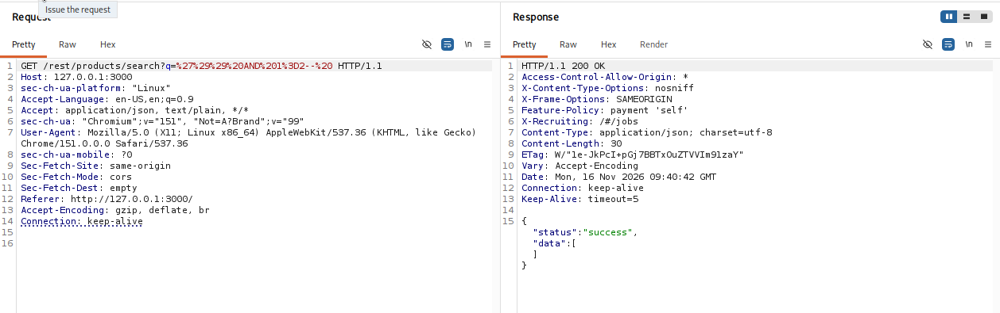
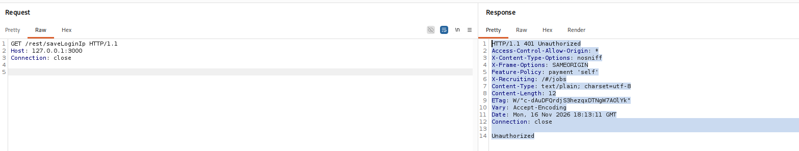
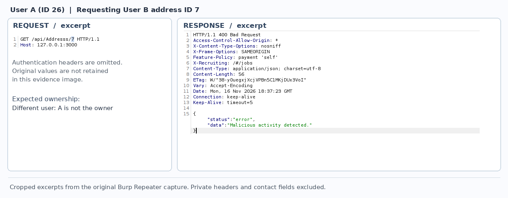
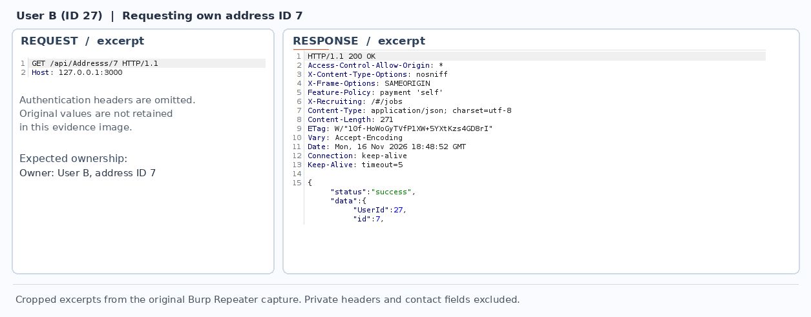

# Web Application Security Assessment — OWASP Juice Shop

**An evidence-driven web application security lab using Burp Suite Community Edition and a locally hosted OWASP Juice Shop instance.**

This project documents controlled manual testing of an intentionally vulnerable web application. The objectives are to analyze HTTP requests, validate security issues with repeatable tests, evaluate access controls, and produce technically accurate reports with remediation guidance.

> **Publication status:** Work in progress. All **nine** screenshots from WEB-001, WEB-002 and WEB-003 have been uploaded and linked. The repository remains private until further testing and a final privacy review are complete. No production systems or third-party accounts are tested.

## Investigation summary

| ID | Area | Observation | Status |
| --- | --- | --- | --- |
| [WEB-001](reports/WEB-001-sql-injection.md) | Input handling / SQL injection | Boolean conditions alter product-search results; a malformed input leaks an SQLite error and query text | **Confirmed, reproducible** |
| [WEB-002](reports/WEB-002-user-data-exposure.md) | API response data exposure | Authenticated `GET /rest/saveLoginIp` returns a nonempty `password` property | **Observed; sensitivity and impact require assessment** |
| [WEB-003](reports/WEB-003-address-access-control.md) | Horizontal access control | Owner B can read address 7; another controlled user A receives a 400 response | **No IDOR demonstrated in the tested scenario** |

**Important:** WEB-003 is a **security-control test**, not a vulnerability finding. WEB-002 should not be treated as confirmed credential disclosure until the returned value has been characterized safely.

## Test environment

| Component | Configuration |
| --- | --- |
| Operating system | Kali Linux virtual machine |
| HTTP testing tool | Burp Suite Community Edition **2026.8** |
| Container runtime | Docker |
| Target application | OWASP Juice Shop (intentionally vulnerable training app) |
| Local target | `http://127.0.0.1:3000` |
| Network exposure | Docker port mapped only to `127.0.0.1` |
| Test users | Two accounts controlled by the lab operator (A and B) |

The **Juice Shop container image tag/digest is not yet pinned**; subsequent runs may differ if `latest` changes. The hypervisor and exact application version have not been established in this report.

## Testing approach

1. Start Juice Shop in a controlled local Docker container.
2. Use Burp's integrated browser and **Proxy → HTTP history** to capture normal requests.
3. Send selected requests to **Repeater** to compare baseline and modified requests.
4. Validate input-handling anomalies through repeatable, controlled test cases.
5. Compare authenticated, unauthenticated, and separate-user requests when assessing data exposure or authorization.
6. Record only supported findings, limitations, and practical mitigation advice.

Read the [laboratory setup](docs/lab-setup.md), [test methodology](docs/testing-methodology.md), and individual reports linked above.

## Selected technical results

### WEB-001 — Product-search SQL injection

**Endpoint:** `GET /rest/products/search?q=...`

- Normal input `q=apple`: `200 OK`, product matches in JSON.
- Single quote `q=%27`: `200 OK`, empty `data` array.
- Input `q=%27%29%29`: `500 Internal Server Error` with `SQLITE_ERROR`, parser detail and a SQL statement in the response.
- Two controlled SQL predicates, `AND 1=1` and `AND 1=2`, yielded product results and an empty `data` array, respectively. The behavior was independently reproduced.

This evidence supports a **confirmed SQL injection** in the local training application. It does **not** establish data exfiltration, account compromise or privilege escalation.

**Evidence at a glance:**

| Control or test | Screenshot | Response |
| --- | --- | --- |
| Initial HTTP baseline | [01 — HTTP history](evidence/01-http-history-baseline.png) | `200 OK` |
| Normal search | [02 — `q=apple`](evidence/02-repeater-search-normal.png) | `200 OK`, products |
| Malformed input | [03 — SQLite error](evidence/03-sqli-sqlite-error.png) | `500`, SQL details |
| True condition | [04 — `AND 1=1`](evidence/04-sqli-true-condition.png) | `200 OK`, products |
| False condition | [05 — `AND 1=2`](evidence/05-sqli-false-condition.png) | `200 OK`, empty array |

For complete evidence and interpretation, see [WEB-001's technical report](reports/WEB-001-sql-injection.md).

### WEB-002 — User attributes in an authenticated API response

An authenticated `GET /rest/saveLoginIp` returned user attributes including a **nonempty `password` property**. The same endpoint without credentials returned `401 Unauthorized`.

The value was deliberately not published or identified as plaintext/hash. The risk assessment is pending; the endpoint's authenticated behavior alone is not proof of unauthorized access.

| Test | Evidence | Result |
| --- | --- | --- |
| Authenticated user | [06 — User-property response](evidence/06-authenticated-user-response.png) | `200 OK`; nonempty `password` attribute observed |
| Unauthenticated request | [07 — Access denied](evidence/07-unauthenticated-401.png) | `401 Unauthorized`; user data not returned |

See [WEB-002 technical assessment](reports/WEB-002-user-data-exposure.md) for observations, limitations and remediation guidance.

### WEB-003 — Address isolation (tested control)

In the local test, an address with ID `7` was owned by user B (ID `27`). User A (ID `26`) received `400 Bad Request` (`Malicious activity detected.`) when requesting `/api/Addresss/7`. A later valid request with user B's authenticated session returned `200 OK` and B's address.

The tested read scenario **did not demonstrate an IDOR**. Other operations and identifiers were not comprehensively tested.

**Owner-based access check — evidence:**

| Test context | Screenshot | Observed result |
| --- | --- | --- |
| User A (ID 26) requests B's address 7 | [08 — Cross-user request rejected](evidence/08-cross-user-address-rejected.png) | `400 Bad Request` |
| User B (ID 27) requests owned address 7 | [09 — Owner request permitted](evidence/09-owner-address-allowed.png) | `200 OK` |

These two cropped evidence excerpts do not contain Authorization headers, cookies, or contact details. See [WEB-003's full assessment](reports/WEB-003-address-access-control.md) for limitations and the distinction between a successful access-control test and a vulnerability finding.

## Documentation

- [Lab setup and safe operation](docs/lab-setup.md)
- [Manual testing methodology](docs/testing-methodology.md)
- [WEB-001 — SQL Injection](reports/WEB-001-sql-injection.md)
- [WEB-002 — Possible excessive user data exposure](reports/WEB-002-user-data-exposure.md)
- [WEB-003 — Address access-control verification](reports/WEB-003-address-access-control.md)
- [Evidence review and upload checklist](evidence/README.md)

## Scope and responsible handling

All requests target a deliberately vulnerable application running **locally**, and all accounts are controlled by the operator. Do not direct these tests at third-party applications without explicit authorization.

Raw proxy logs, JWTs, cookies, credentials, user addresses, and unsanitized screenshots must **not** be committed. Keep the repository private until the evidence is reviewed.

---

*Independent educational project · Web application assessment · Burp Suite Community · In progress.*

