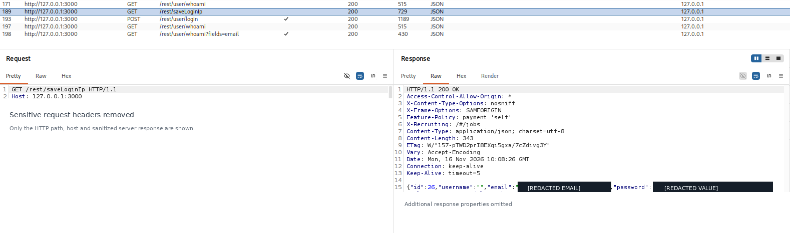
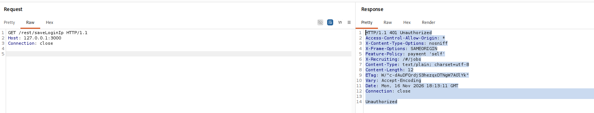

# WEB-002 — Potential excessive exposure of user attributes

**Status:** Observed; nature of `password` value and security impact not established  
**Affected endpoint:** `GET /rest/saveLoginIp`  
**Relevant category:** Excessive response data / object property exposure  
**Severity:** Pending assessment

## Observations

With an authenticated lab account, `GET /rest/saveLoginIp` returned a user JSON object with fields including `id`, `email`, `role`, `password`, `totpSecret`, `lastLoginIp`, and `isActive`.

- The `password` property held a **nonempty value** in the observed responses. Its value was redacted and its representation (e.g., hash or other) **was not verified**.
- The `totpSecret` and `lastLoginIp` fields were empty strings in the reviewed example.
- A request to the same endpoint **without** authentication headers or cookies returned **`401 Unauthorized`**.
- Separate lab users A and B received their own user records when authenticated.

## Assessment

Including a `password` property in an API response warrants review even when returned to an authenticated account. If the property is a password hash or another sensitive credential artifact, its transmission to a browser may represent unnecessary exposure. However, the screenshots do **not** prove plaintext credential disclosure, access by an anonymous requester or access to another user's record.

**This is a potential data-minimization weakness, not yet a confirmed high-impact vulnerability.**

## Recommended remediation / next checks

- Return an explicit allowlist of fields needed by the client, excluding password representations and authentication secrets.
- Verify the exact serialized value type and intended client use without copying secrets into reports.
- Keep the endpoint protected by authentication and independently evaluate horizontal authorization where appropriate.

## Evidence — authenticated vs unauthenticated requests

### 06 — Authenticated request: HTTP 200

An authenticated `GET /rest/saveLoginIp` returned a JSON user object with fields including `id`, `email`, `role`, `password`, `totpSecret`, and `isActive`. In the captured response, the `password` property contained a **nonempty value**. Its content is not reproduced and has not been characterized.

### 07 — Request without credentials: HTTP 401

The same endpoint was requested without the Bearer authorization header or session cookies. It responded with `401 Unauthorized` and did not return the user object.

### Assessment from the two captures

| Test condition | Observed result | Supported conclusion |
| --- | --- | --- |
| Authenticated lab user | `200 OK`; user attributes include nonempty `password` field | Potentially unnecessary exposure of a sensitive attribute |
| No authentication | `401 Unauthorized`; no user attributes returned | Anonymous access was rejected in this test |

The evidence supports a **data-minimization concern**, not plaintext-password disclosure or authentication bypass. Both captures were taken against a local intentionally vulnerable training application, then redacted before upload. The repository must remain private until all later authenticated-session evidence and release checks are complete.
