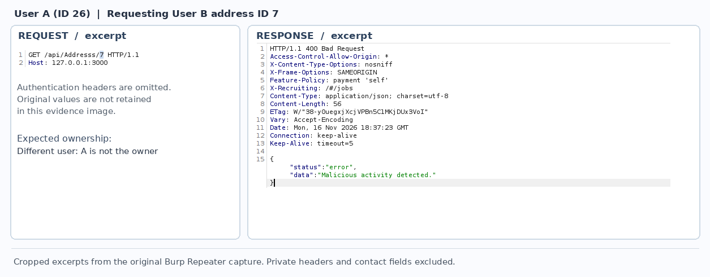
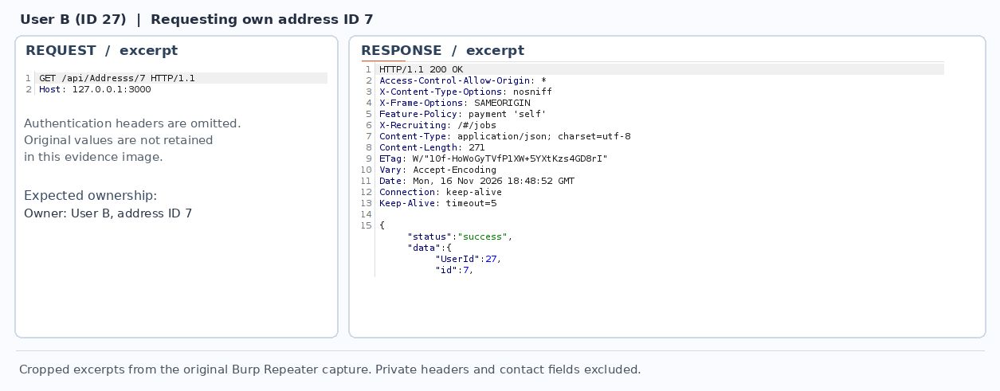

# WEB-003 — Horizontal access control: address lookup

**Status:** Tested; no cross-user read access observed in this scenario  
**Category:** Authorization validation (not a confirmed vulnerability)  
**Endpoint:** `GET /api/Addresss/7` (spelling as observed)

## Test setup

Two accounts controlled by the lab operator:

- **User A:** ID `26`
- **User B:** ID `27`, owner of address ID `7`

The test address used fictional contact information. The address creation request `POST /api/Addresss/` returned `201 Created`, with address ID `7` associated with user ID `27`. The owner's list endpoint `GET /api/Addresss` returned the same association.

## Results

| Test | Observation |
| --- | --- |
| User A requesting `/api/Addresss/7` | `400 Bad Request`; application message `Malicious activity detected.` |
| User B requesting `/api/Addresss/7` with a valid B session | `200 OK`; address 7 returned with `UserId: 27` |

An earlier attempt using the supposed B context also returned `400`; after rechecking the session and making a new owner request, `200` and the expected owned record were observed. The earlier failed attempt is **not** represented as proof of a vulnerability or an enforcement control by itself.

## Interpretation

This controlled comparison is **consistent with** authorization restricting the tested single-address read to the owner. The experiment did not demonstrate an IDOR in this endpoint. It is not a comprehensive test of all address operations, routes or resource identifiers.

## Verified evidence — Burp Repeater

The following are **cropped excerpts** from the original controlled tests conducted on **16 November 2026**. The screenshots retain the original request path, HTTP status and relevant JSON response, while excluding Authorization headers, cookies and contact information.

### 08 — Cross-user request: rejected

**User A (ID 26)** requested address `7`, belonging to user B. The server returned `400 Bad Request` with the message `Malicious activity detected.`

### 09 — Owner request: permitted

**User B (ID 27)** requested the same address `7` while authenticated as its owner. The server returned `200 OK`, with the response showing `UserId: 27` and `id: 7`.

### Conclusion and limitations

| Request context | Response | Interpretation |
| --- | --- | --- |
| User A, address owned by B | `400 Bad Request` | No cross-user address data obtained |
| User B, owner of address | `200 OK` | Owner receives the expected resource |

The tested behavior is **consistent with owner-based authorization** for this particular resource-read operation. No IDOR was demonstrated. It does **not** prove that every address-related endpoint or HTTP method is protected.

The full set of uploaded evidence is indexed in [`evidence/README.md`](../evidence/README.md). This report is published with sanitized evidence; no IDOR was demonstrated in the tested scenario.
